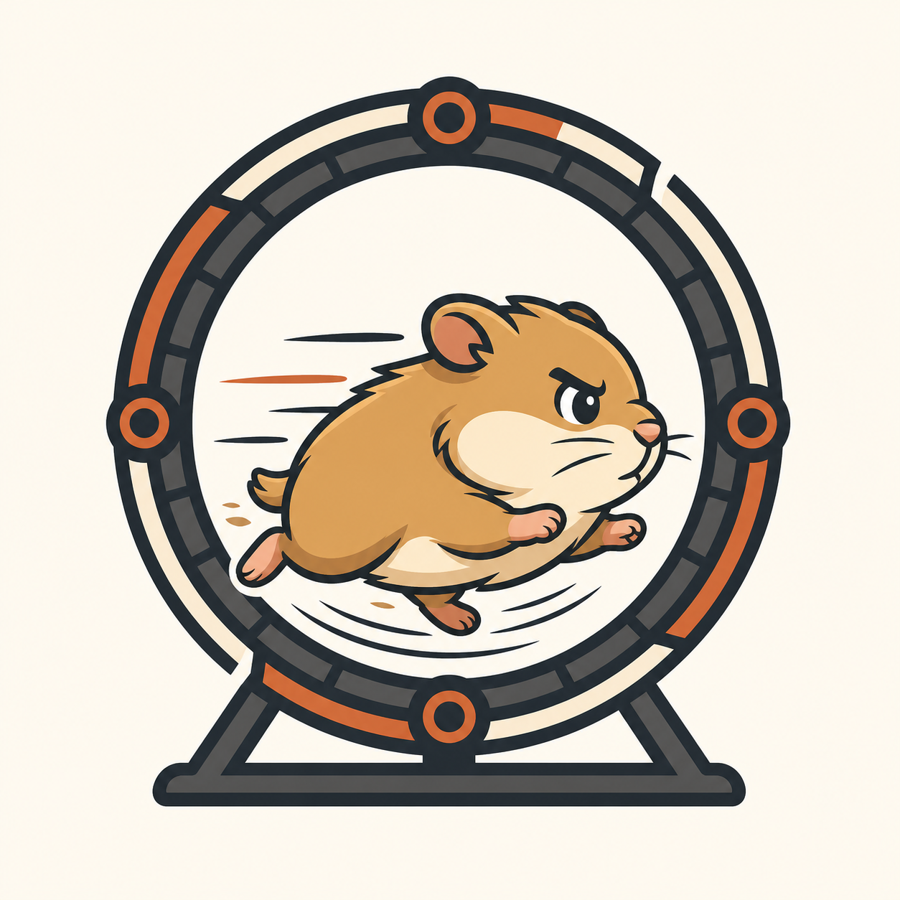

<div align="center">
  

  <h1>Hamster</h1>

  <p>A small language and runtime for enforceable, resource-bounded Codex loops — and lazyloop, the screen you run them from.</p>

  <p>
    <a href="https://github.com/kavishsathia/hamster/actions/workflows/ci.yml"></a>
    
    
    
    
    <a href="LICENSE"></a>
  </p>
</div>

The project is bootstrapping its trusted kernel. Design decisions and live
Codex hook findings are recorded in [`discussions`](discussions/).

Contributions are welcome. Read [CONTRIBUTING.md](CONTRIBUTING.md), the
[Code of Conduct](CODE_OF_CONDUCT.md), and the [Security policy](SECURITY.md)
before opening an issue or pull request.

## Development

```sh
go test ./...
go run ./cmd/hamster version
```

## Bootstrap CLI

Build the native binary and initialize a trusted repository:

```sh
go build -o bin/hamster ./cmd/hamster
bin/hamster init
```

`init` creates `.hamster/scripts`, preserves and extends any existing
`.codex/hooks.json`, and prints the Codex hook-trust step. Inside Codex, the
agent starts a repository loop with:

```sh
hamster run build-provider
hamster status
```

For a declarative `goal`, every hook-visible tool call triggers its ordered
verifier ladder. Hamster stops at the first failed verifier and reports it to
Codex; when every verifier passes, the goal completes automatically. Adding
`with flow` changes the cadence: Hamster waits for the complete ordered flow
cycle before probing the goal. `hamster signal goal-achieved` remains available
as an optional immediate probe, but correctness does not depend on Codex
remembering to call it.

## lazyloop

lazyloop is to loop engineering what lazygit is to git: the state on screen,
the actions one key away, and nothing about the command surface to remember.
`hamster` is the language and the kernel underneath; `lazyloop` is what you
type.

```sh
go install ./cmd/lazyloop   # once
lazyloop setup              # once — the hook goes into ~/.codex, for every project
cd ~/some/project
lazyloop
```

Each loop gets its own Codex — a fresh process, a fresh session, its own
context — and several run at once. You land on the dashboard; selecting an
agent row and pressing `ctrl-]` opens that agent's Codex, and `ctrl-]` flips
back. Every agent runs the whole time, drawn only while it is the one on
screen, so a trap in any loop rings the bell even while you watch another.

The dashboard is three panels, lazygit style. On the left, the list of loops
— every loop you have ever run in this directory, persisted across sessions,
each with a coloured dot for its status (blue running, green complete, red
failed, amber waiting on you) and, beside it, how many tool calls it has made
and how long it has run, ticking live while it works. Under each loop its
agents are indented: the root Codex today, and any subagents it forks as
loops grow. Top-right, the selected loop's goal or script.
Bottom-right, its log: the tool calls, the verifier results with their
output, the traps. Both right panels scroll.

- `↑ ↓` move the cursor over the list — loops and, indented under them, their
  agents — or scroll the focused right panel. Click a row to select it. `Tab`
  moves focus between the three panels.
- `ctrl-]` opens the Codex of the **agent** you have selected (a row under a
  loop); select an agent row first, then `ctrl-]`, and `ctrl-]` again returns.
- `n` opens the loop builder. You compose a loop from one-key recipes and
  the goal panel shows the script forming live: `l` a time limit (minutes),
  `a` an attempt limit, `m` a machine check (a shell command that must pass),
  `j` a judge (an agent reviews for what you describe), `t` a trap (a question
  for you). `⌫` undoes the last recipe; `⏎` starts the loop — which spawns its
  Codex and hands it the task. It won't start without at least one check.
- A waiting trap is answered with `a`, `r` (with a note), or an option
  number; the bottom bar shows the question.
- `d` twice stops the selected loop — killing its Codex and its run.
- `Ctrl-C` or `q` quits lazyloop, stopping Codex with it.

`HAMSTER_AGENT` swaps Codex for another command, for example
`HAMSTER_AGENT=claude`. A bare `hamster` opens the same screen.

## Traps

`verify` asks the machine. `trap` asks the person. A trap suspends the run and
transfers control to the supervising human for a decision Hamster cannot
compute.

In a `goal` a trap is a **completion gate** on the verifier ladder — the run
cannot certify itself done:

```hmstr
goal {
  limit traps 2;
  verify tests_pass = bash.check("go test ./...");
  verify vet_passes = bash.check("go vet ./...");
  trap "Do the new exported names match the package?";
  return tests_pass;
}
```

Traps are always evaluated after every verifier regardless of source order, so a
person is only ever asked about work the machine has already accepted — a
failing test never costs you a question.

A goal needs at least one gate, but not a machine-checkable one. Work whose only
standard of completion is a person's judgement is gated entirely by traps, and
Hamster does not demand a token verifier to dress it up as objective:

```hmstr
goal {
  limit traps 4;
  trap "Is this any good?";
  return "done";
}
```

In a `flow` a trap is instead a **checkpoint** between steps:

```hmstr
} with flow {
  step build = bash.run("go build ./...");
  trap "Is this the right shape before I continue?";
}
```

While a trap is open the run's status is `trapped` and **every** agent tool call
is denied — allowing work to continue would make the answer arrive too late to
matter. The agent may read the queue, but `hamster resolve` is denied at the
hook: a trap is only a real transfer of control if the agent it suspends cannot
answer it.

How the question reaches you depends on whether you are there.

**In an interactive session**, every tool call is denied and the agent is told to
end its turn and put the question to you. Ending the turn is how control returns
to a person — Codex rejects an `ask` permission decision, so there is no way for
Hamster to raise a prompt of its own. Your reply resolves it:

```
> approve
> reject the names read like Java
> choose sentinel
```

Hamster has no model, so it never interprets: the reply must start with the word
the question asked for. Anything else leaves the trap open and repeats the
question. A rejection must say what was wrong, because that reasoning is what
the agent re-derives the work from.

**Unattended**, there is nobody to ask, so the question waits in a queue you
answer from outside Codex, in batch:

```sh
hamster traps
hamster resolve <trap-id> --approve
hamster resolve <trap-id> --reject --note "reads better"
```

Hamster also refuses to let an agent end its turn while a loop is unfinished. A
`Stop` with work still pending is blocked once, with a continuation prompt
naming the next permitted action — so an agent cannot quietly abandon a loop.
Once is the limit: Codex re-enters with `stop_hook_active`, and a second block
would trap the agent forever.

Approval advances the flow. Rejection re-derives the work from the machine's
initial state exactly like a failed verifier, so a verdict costs a re-run and
never a rewrite — and rejection requires a `--note`, because the agent re-enters
the loop from that reasoning. A selection trap pairs with `fork`: run the
alternatives to completion, then choose between finished results.

```hmstr
trap "Which error style?" ["result-type", "sentinel"];
```

The compiler's job is to guarantee the emitted state is answerable: only
`user.approve` and `user.select`, a static prompt, and a closed option set, all
checked before the run starts. Supervisor attention is a budgeted resource —
`limit traps N` fails closed rather than quietly filling the review queue.
Traps are keyed by run, state, and iteration, so a replayed hook re-attaches to
the same question instead of asking it twice, and open traps survive daemon
restarts.

### What this enforcement is and is not

Hamster decides who may run what by inspecting the tool calls Codex reports
through its hooks. A Hamster command must therefore be the entire tool call —
one composed with other shell work is refused, because a command the parser
cannot read is a command the authority split never sees.

That makes this a strong guardrail against drift, not a sandbox. The agent runs
as you, so it can reach the daemon socket directly and skip the hook entirely if
it sets out to. Supervisor-only commands are protected against an agent taking a
shortcut, not against one deliberately evading the runtime. Treat the real
boundary as the sandbox Codex runs in.

## Taste profile

A trap spends the scarcest resource in the loop: your attention. The way to
spend less of it is to state a standard once instead of answering the same
question every run.

The agent conducts the interview and reports what it heard. That proposal is a
draft and carries no authority:

```sh
hamster taste record --name error_style \
  --clause "Wrap with %w; never bare errors.New in internal/"
```

You review and adopt it, outside Codex:

```sh
hamster taste show --drafts
hamster taste ratify
```

The split is the point. The agent proposes and reads; only a supervisor adopts.
`hamster taste ratify` and `hamster taste revoke` are denied at the hook, and a
ratified clause is immutable until explicitly revoked — so an agent can never
loosen the standard it is graded against. `hamster taste show` returns only
ratified clauses, so an unratified proposal can never be applied as if it were
your standard. The profile is repo-scoped and persists, so the interview happens
once rather than every session.

This is the standing a `judge` applies: an observer has no aesthetic authority
of its own, only what this profile grants it.

## Judge

A `judge` spends your ratified standards instead of your attention. It is the
automated counterpart of a trap:

```hmstr
} with flow {
  step build = bash.run("go build ./...");
  judge "the new exported names match the package";
}
```

The observer applies your whole ratified profile. There is no judge instruction
in the runtime — it desugars into `fork`, `exec`, `wait`, and a verdict dispatch, and
that desugaring is the enforcement:

- **No contamination.** The observer is a different subagent running a
  different program. `exec` clears the working agent's context, so the
  reasoning that produced the work never reaches the judgement of it.
- **No standing of its own.** It applies your ratified standards. With none
  adopted the observer never runs at all and the judgement escalates to you.
- **Cannot touch the work.** It investigates the workspace as a reviewer would,
  but `apply_patch` is denied, so it cannot edit what it is judging.

Verdicts are three-valued. A pass advances, a fail re-derives the work like any
failed gate, and an abstention transfers control to a supervisor. A pass or
fail with no `--cite` is coerced to an abstention — an unsupported opinion
escalates to a human rather than passing as your taste. An observer answers
once, and one that never speaks times out and abstains rather than hanging its
parent.

Repeated failure of the same judgement becomes your question — a taste failure
the agent cannot perceive will not fix itself, and repeating it spends attempts
without converging. `limit judgements N` bounds the money observers cost, which
is a different resource from the attention `limit traps N` bounds.

## Audits, and how the queue shrinks

A judge is only as trustworthy as the clause behind it. A sample of passing verdicts is set
aside for a spot-check:

```sh
hamster audits
hamster audit <judgement-id> --agree
hamster audit <judgement-id> --flag --note "Abbreviations are never package idiom."
```

An audit questions the *observer*, not the work, so it never blocks a run — the
run already advanced on the verdict. Auditing is denied to the agent at the
hook: an agent grading its own grader proves nothing.

Both correction paths feed the profile. Resolving an escalated trap with a
`--note`, or flagging an audit, records your reasoning as a **draft refinement**
of the clause the observer applied. The standing profile is untouched until you
adopt it:

```sh
hamster taste show --drafts
hamster taste ratify --name naming
```

That is the whole arc. A question you answer once becomes a clause; the clause
lets an observer answer it without you; auditing tells you when the clause has
gone stale; and every correction you make is proposed back as taste. Your
attention is spent on what the profile does not yet cover, and the set of things
it does not cover only shrinks.

If a loop is preventing work needed to repair Hamster itself, use the
high-priority emergency brake:

```sh
hamster kill --reason "repair Hamster runtime"
```

The pre-tool hook handles `kill` before normal loop policy. It persistently
marks the bound run as killed — including one suspended at a trap or a wait —
cancels its open questions, and removes the current agent binding, so later
tool calls are no longer governed by that run. Outside Codex, identify the
binding explicitly with `hamster kill --session <session-id>`.

The pre-tool hook owns registration because it already has the Codex session
and agent identity. For local testing outside Codex, bind explicitly:

```sh
hamster run --session test-session .hamster/scripts/build-provider.hmstr
hamster status --session test-session
```

Runtime state is owned by one per-user daemon in `~/.hamster/hamster.db`. The
current bootstrap supports persistent `goal`, `flow`, nested loops, `foreach`,
prospective time, attempt, and trap limits, `allow`/`disallow`, exact `bash.run`
steps, independent `bash.check` verifiers, supervisor `trap` suspension, and
OS-like `fork`/`exec`/`wait`. On every database open, Hamster idempotently
repairs terminal bindings, completed waits, interrupted fork snapshots, and
traps orphaned by a dead run. Replayed hook control
requests reuse their persisted decision.

When a flow reaches `step child = fork;`, Hamster permits exactly one Codex
subagent spawn and snapshots the complete run. The child's stable
`(session_id, agent_id)` hook identity is automatically bound to that pending
snapshot when it first appears. Parent and child receive different fork-handle
attributes. Hamster—not Codex—then performs the child-only exec and parent wait
transitions:

```hmstr
step child = fork;
if child.child {
  exec child-workflow;
}
wait child;
```

Normal loop `return` completes the child, clears its binding, and wakes a
waiting parent. `exec` clears the old machine stack and machine-local limits;
`wait` currently accepts direct children. While suspended, Codex may use its
native `wait_agent` operation; Hamster alone evaluates the language-level wait.

## Playground

The observability console watches a session you are already running. The
playground is the other half — a place to try a loop before it governs real
work:

```sh
hamster playground     # http://127.0.0.1:7332
```

Write a loop, give it a task, add taste clauses, and run it. Every experiment
gets a throwaway workspace of its own, so two runs of the same task start from
identical state and nothing an experiment does reaches anything you care about.
The page compiles the loop as you type, and the timeline shows what the agent
tried beside what Hamster decided about it.

The playground keeps its own Codex home. Hooks that live in a throwaway
workspace are discovered but never trusted, and Codex treats an untrusted hook
as absent — the loop would appear to run while enforcing nothing. A stable home
means one hook file whose trust survives every experiment. It borrows the login
from your own Codex home, so run `codex login` first.

## Runtime observability

The daemon hosts a local operational console on a loopback-only HTTP listener.
Print its current address with:

```sh
hamster ui
```

The console shows every known Codex session and its agent process tree. A run
detail view exposes the current machine and state, iteration, nested stack,
activated limits, recent hook decisions, paired tool durations, and persisted
verification evidence. It polls the local daemon directly; no runtime data is
sent to an external service and no separate frontend process is required.

The default listener is `127.0.0.1:7331`. Use
`hamster daemon serve --http 127.0.0.1:0` when an ephemeral port is preferable;
the resolved URL is still available through `hamster ui`.

## Language and integration reference

Hamster ships an offline reference catalog. It records syntax, preconditions,
postconditions, guarantee levels, verification evidence, stable failures, and
tested examples for every current language and process primitive:

```sh
hamster man fork
hamster man --search "child process"
hamster man --list
```

The separately hosted documentation website is generated from that same
catalog; it is not part of the runtime daemon or observability console. Source
and the Astro + Starlight adapter live under `docs/`. A deployment supplies its
public origin through `SITE_URL` and builds the static site with
`pnpm --dir docs/site run build`.

## Codex trace fixtures

Hamster can record the hook stream directly from Codex. Inside a Codex session:

```sh
hamster trace record --name parallel-provider-build
# exercise the workflow
hamster trace stop
hamster trace export --id <trace-id> --output testdata/traces
```

The pre-tool hook supplies the session identity and detects the exact installed
Codex version. Exports are sanitized and automatically organized as:

```text
testdata/traces/<codex-distribution>-<exact-version>/<scenario>/
```

Replay a fixture without launching Codex:

```sh
hamster trace replay testdata/traces/codex-cli-0.144.5/parallel-subagents
```

The committed `codex-cli 0.144.5` corpus covers parallel subagents, a nested
subagent, native web search, shell calls, spawn/wait operations, lifecycle
events, and stable parent/child identities. Runtime replay uses an injectable
clock and queued verifier results, so tests do not sleep or execute captured
commands.
